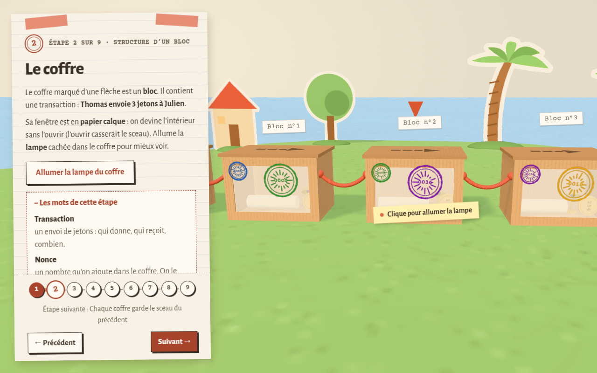
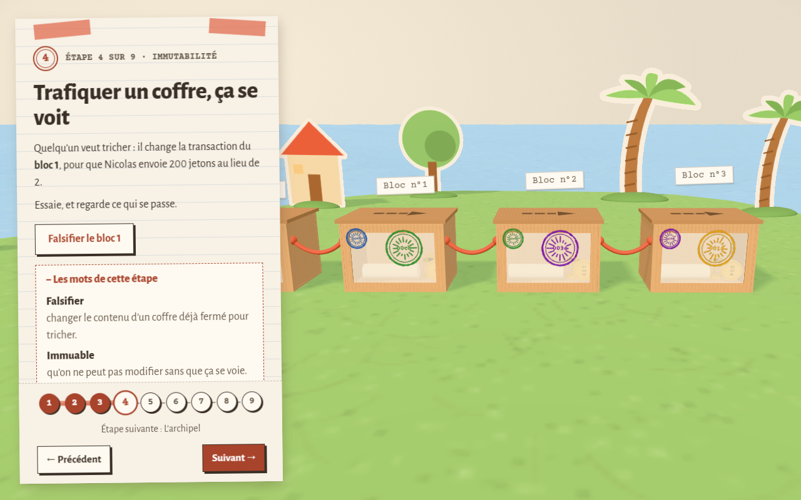
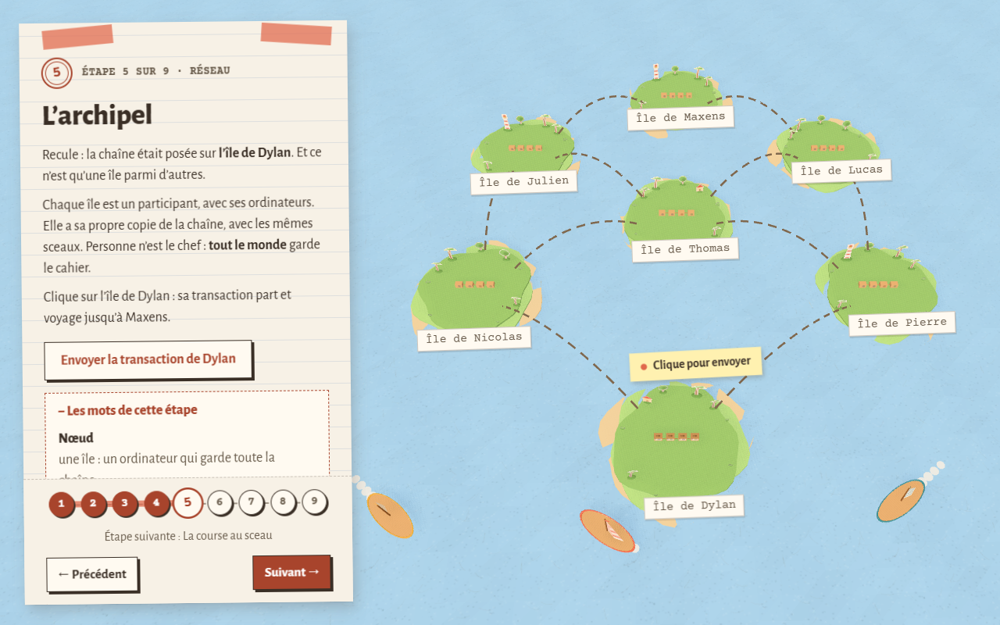
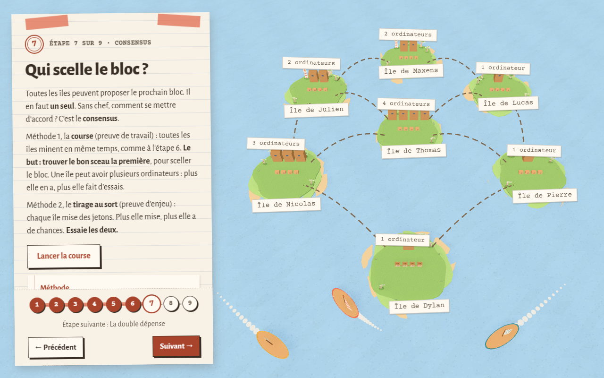
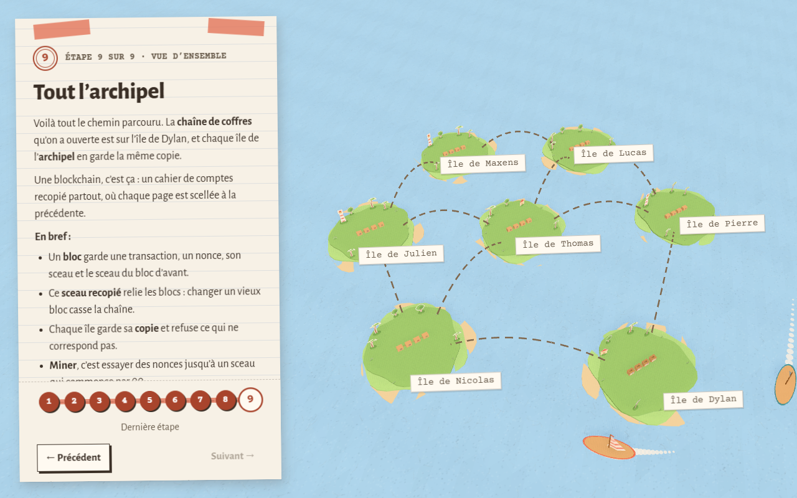

# Blockchain 3D — R507

Expérience web interactive en 3D (Three.js) pour faire comprendre une blockchain à un public non initié.
Projet du module R507, BUT MMI 3e année.

- **Démo en ligne** : https://dyzlek.github.io/r507-blockchain-3d/
- **Board GitHub Projects** : https://github.com/users/dyzlek/projects/3

## Équipe

| Membre | GitHub | Rôle |
|:---|:---|:---|
| Maxens | [@MaxX-J](https://github.com/MaxX-J) | Design, UX et contenu pédagogique · documentation et tests utilisateurs |
| Dylan | [@dyzlek](https://github.com/dyzlek) | Développement 3D et intégration Three.js · board GitHub Projects et déploiement |

## Le parcours

Une maquette en papier découpé posée sur un bureau : des coffres en carton pour les blocs, des tampons encreurs pour les empreintes, des îles et des avions en papier pour le réseau. Le fil rouge suit une transaction, « Dylan envoie 5 jetons à Maxens », de sa création jusqu'à une tentative de double dépense. Chaque étape a un encart « En vrai… » qui donne le terme technique exact et la limite de l'image, et une liste repliée « Les mots de cette étape » qui définit les termes nouveaux.

| Étape | Notion | Titre à l'écran |
|:-:|:---|:---|
| 1 | Introduction | Une chaîne de coffres en carton |
| 2 | 1. Structure d'un bloc | Le coffre |
| 3 | 2. Chaînage cryptographique | Chaque coffre garde le sceau du précédent |
| 4 | 3. Immutabilité et détection de falsification | Trafiquer un coffre, ça se voit |
| 5 | 4. Réseau et décentralisation | L'archipel |
| 6 | 5. Validation et minage | La course au sceau |
| 7 | 6. Consensus (preuve de travail et preuve d'enjeu) | Qui scelle le bloc ? |
| 8 | 7. Cycle de vie d'une transaction et attaque | La double dépense |
| 9 | Vue d'ensemble | Tout l'archipel |

Les empreintes sont de vrais SHA-256 calculés dans le navigateur.

## Captures

| Étape 2 · Le coffre | Étape 4 · Trafiquer un coffre |
|:-:|:-:|
|  |  |

| Étape 5 · L'archipel | Étape 7 · Qui scelle le bloc ? |
|:-:|:-:|
|  |  |

| Étape 9 · Vue d'ensemble |
|:-:|
|  |

## Utiliser l'expérience

- **Changer d'étape** : boutons « Précédent / Suivant », pastilles numérotées, ou flèches ← → du clavier.
- **Ouvrir une étape directement** : `?etape=N` (de 1 à 9), par exemple `https://dyzlek.github.io/r507-blockchain-3d/?etape=5`. Pratique pour les tests et la soutenance.
- **Regarder la scène** : glisser pour tourner, molette ou pincement pour zoomer. Sur téléphone, la fiche passe en bas de l'écran.
- **Agir** : cliquer sur le coffre ou sur le bouton du panneau (lampe, falsifier, envoyer, lancer le minage, lancer la course). À l'étape Réseau, les îles s'éteignent au clic ou avec les boutons « Éteindre une île ».

## Accessibilité

Contrastes du texte mesurés à 4,5 ou plus, états toujours doublés par du texte ou un symbole (pas de couleur seule), focus visible, parcours entièrement faisable au clavier, texte de l'étape annoncé aux lecteurs d'écran, animations réduites avec `prefers-reduced-motion`. Les chiffres et les limites (pas encore testé sur un vrai téléphone ni avec un lecteur d'écran) sont dans la section 2.5 de `CHOIX-MODELISATION.md`.

## Lancer le projet en local

Prérequis : Node.js 20 ou plus.

```bash
npm install
npm run dev
```

Puis ouvrir l'URL affichée (par défaut http://localhost:5173/r507-blockchain-3d/).

`npm run build` produit la version statique dans `dist/`, `npm run preview` la sert en local.

### Mesurer la fluidité

`scripts/mesure-fps.mjs` ouvre Chrome, parcourt les 9 étapes en déclenchant leur action et affiche, pour chaque étape, les images par seconde (moyenne et pire seconde). Il dure environ une minute.

```bash
node scripts/mesure-fps.mjs                 # démo en ligne
node scripts/mesure-fps.mjs --cpu 4         # processeur ralenti 4 fois (PC faible)
node scripts/mesure-fps.mjs --gpu high      # carte graphique dédiée (portable à deux cartes)
node scripts/mesure-fps.mjs --browser edge  # autre navigateur : edge ou firefox (Firefox : ni ralentissement, ni choix de carte)
node scripts/mesure-fps.mjs http://localhost:4173/r507-blockchain-3d/   # version locale (npm run preview)
```

Pour regarder la fluidité à la main, dans n'importe quel navigateur : appuyer sur **R et P en même temps** affiche un compteur en haut à droite (images par seconde, moyenne et pire demi-seconde depuis l'ouverture) ; même raccourci pour le cacher.

Le critère est d'au moins 30 images/s. Résultats et méthode : CHOIX-MODELISATION §3 (#57).

## Technologies

[Three.js](https://threejs.org/) (rendu 3D, étiquettes CSS2D, lignes `Line2`), [Vite](https://vite.dev/), JavaScript sans framework. Polices : Alegreya Sans et Courier Prime (Google Fonts). Aucune autre dépendance.

## Déploiement

Chaque push sur `main` déclenche le workflow [`.github/workflows/deploy.yml`](.github/workflows/deploy.yml), qui construit le site et le publie sur GitHub Pages.

## Structure

```
index.html           page unique (panneau, canvas)
apercu-papier.html   page d'aperçu de la direction papier (maquette de travail)
src/
  main.js            scène, panneau, navigation, caméra
  sequences.js       textes et réglages de chaque étape
  coffre.js          coffre, sceau et tampon encreur
  chain.js           blocs et calcul des SHA-256
  papier.js          calque, ruban, corde simulée, découpes
  nuages.js          nuages en volume entre la chaîne et l'archipel
  bateau.js          bateaux en papier et leur sillage
  archipel.js        îles, routes, avions (notion 4)
  minage.js          essais de nonce (notion 5)
  consensus.js       preuve de travail et preuve d'enjeu (notion 6)
  race.js            course entre deux branches (notion 7)
  apercu-papier.js   page d'aperçu de la direction papier
  style.css          charte visuelle
scripts/
  mesure-fps.mjs     mesure des images par seconde sur les 9 étapes (#57)
docs/
  CADRAGE.md         document de cadrage
  MMI-R507-projet-blockchain-CHOIX-MODELISATION.md   livrable officiel des choix
  MMI-R507-projet-blockchain-GRILLE-AUTOEVAL.md      auto-évaluation avant soutenance
  STORYBOARD.md      storyboard écrit du parcours complet (9 étapes)
  captures/          captures d'écran du README
  TEST-UTILISATEUR.md   protocole de test utilisateur
  TEST-UTILISATEUR-RESULTATS.md   résultats des sessions de test
  SOUTENANCE.md      plan minuté et répartition de la soutenance
  suivi/SEMAINE-01.md … SEMAINE-08.md                fiches hebdomadaires
```

## Tests utilisateurs

Le protocole (consignes, questions par étape, grille d'observation) est dans [`docs/TEST-UTILISATEUR.md`](docs/TEST-UTILISATEUR.md). Les retours sont reportés dans les sections « Tests utilisateurs » de chaque notion de `CHOIX-MODELISATION.md`. Les résultats sont dans [`docs/TEST-UTILISATEUR-RESULTATS.md`](docs/TEST-UTILISATEUR-RESULTATS.md). Session 1 (#17) : 2 testeurs extérieurs ; les notions 1 à 3 passent, les étapes 4 à 7 et le lien « sceau recopié » posent problème ; les corrections sont notées dans CHOIX et suivies dans #45 (rythme), #46 (vocabulaire, lexique par étape) et #47 (copie du sceau animée). Session 2 (#18, 11/11) : 2 testeurs qui n'avaient jamais vu le projet ; T4 atteint le critère du protocole (7 réponses sur 8 justes), T3 non (0 sur 8), plus aucune étape jugée incompréhensible. Retours traités dans #55 (PR #54) ; report dans les fiches de CHOIX suivi dans #56, nouvelle mesure des FPS dans #57.

## Organisation et suivi

Le board ([projet 3](https://github.com/users/dyzlek/projects/3)) a les 5 colonnes communes : Backlog, À faire, En cours, À vérifier, Terminé. Chaque issue a un type, une priorité et, pour les notions, un label « notion : N » ; elle est rattachée à un jalon (M1 Cadrage 09/10, M2 Livraison 15/11, M3 Soutenance 19/11). Une issue fermée l'est avec sa preuve : PR, commit ou fichier de résultats.

### Répartition du travail

| | Dylan (@dyzlek) | Maxens (@MaxX-J) |
|:---|:---|:---|
| Issues assignées | #1, #3, #6 à #9, #11, #15, #19, #21, #24, #45 à #47, #55 à #58 (et #2, #5, #25 à deux) | #4, #10, #12 à #14, #16 à #18, #20, #22, #23 (et #2, #5, #25 à deux) |
| Domaine | Scène 3D et intégration Three.js, notions 1, 2, 3 et 5, caméra et transitions, performances, déploiement, board | Direction « maquette en papier », charte et accessibilité, notions 4, 6 et 7, storyboard, CHOIX-MODELISATION, protocole et sessions de tests utilisateurs |
| Commits sur `main` (hors fusions, au 16/11) | 71 | 15 |

L'écart de commits ne mesure pas l'écart de travail : une partie du travail de Maxens se fait hors du dépôt (formulaires Google des tests, relectures). Dylan, chargé de l'intégration, fusionne aussi dans le code des éléments conçus à deux, et fait beaucoup de petits commits de correction. Un commit (651209c, 13/10, notion 5) porte l'auteur « Claude » : il a été créé avec l'identité de l'assistant IA au lieu de celle de Dylan ; son contenu est déclaré dans l'usage de l'IA ci-dessous (ligne du 13/10).

### Commits sans numéro d'issue

11 commits sur `main` n'ont pas de numéro d'issue dans leur message. Ils sont rattachés ci-dessous ; depuis le 10/11, tous les commits citent leur issue.

| Commit | Date | Rattaché à |
|:---|:---|:---|
| 20549df initialisation du projet | 01/10 | #1 |
| 52d1608 notions 4 et 5 relues, transitions | 13/10 | #10, #11, #15 |
| 593a861 étiquettes réduites, archipel replié | 13/10 | #15 |
| 50421f3, 1af535a fiche de suivi semaine 3 | 19/10 | fiches de suivi (pas d'issue dédiée après la semaine 1, #6) |
| 2db15bf, 8667670, dcf58e7, 3b94ceb bateaux | 09/11 | #16 (décors), via la PR #39 |
| 76796c8 consigne du minage, bloc 4 sans sceau | 09/11 | #11, via la PR #39 |
| d7a0eed sceaux colorés par paire | 10/11 | #47, via la PR #43 |

## Notions couvertes

1. Structure d'un bloc
2. Chaînage cryptographique
3. Immutabilité et détection de falsification
4. Réseau et décentralisation
5. Validation et minage
6. Comparaison d'au moins deux mécanismes de consensus
7. Cycle de vie d'une transaction et scénario d'attaque illustré

## Usage de l'IA générative

L'IA générative (Claude) est utilisée comme assistant. Tout code ou texte généré est relu, testé et compris par le groupe. Les usages sont signalés dans les issues et commits concernés, et détaillés dans la section 6 de `CHOIX-MODELISATION.md`.

| Date | Usage | Vérification |
|:---|:---|:---|
| 01/10/2026 | Mise en place du dépôt (Vite, workflow Pages, structure docs, issues initiales) | Relu par le groupe, build et déploiement testés |
| 09/10/2026 | Création du board GitHub Projects, assignation des issues, première rédaction du cadrage (public, métaphore, fil rouge) et de la fiche semaine 1 | Relu et validé par le groupe |
| 12/10/2026 | Squelette du parcours par séquences, caméra guidée, coffre de verre de la notion 1 (#15, #7) ; brouillon des §3 et §4.1 de CHOIX-MODELISATION | Testé sur ordinateur et téléphone ; relu par Maxens |
| 13/10/2026 | Notion 4 : archipel, propagation de la transaction, îles éteignables (#10) ; fiches §4.2, §4.3 et §4.4 de CHOIX-MODELISATION (4.2 et 4.3 rédigées à partir du code) ; navigation sur deux lignes (#15) | Vérifié sur ordinateur et téléphone, relu par Maxens ; 4.2 et 4.3 à confirmer par Dylan, tests utilisateurs à faire |
| 13/10/2026 | Notion 5 : coffre n°4 à miner, essais de nonce en direct, choix de difficulté `00` / `000` (#11) ; fiche §4.5 de CHOIX-MODELISATION | Testé sur ordinateur et téléphone (navigateur automatisé) ; à relire par Maxens et Dylan, tests utilisateurs à faire |
| 13/10/2026 | Notions 6 et 7 : consensus PoW / PoS sur l'archipel (#12), cycle de vie et double dépense avec course entre deux branches (#13) ; fiches §4.6 et §4.7 de CHOIX-MODELISATION | Testé sur ordinateur et téléphone ; à relire par Maxens et Dylan, tests utilisateurs à faire |
| 13/10/2026 | Branche `styleV2` : nouvelle direction artistique « maquette en papier découpé » sur tout le parcours (coffres en carton à fenêtre de calque, tampons encreurs, ruban adhésif, îles et avions en papier, interface en fiche cartonnée) ; §2.5 de CHOIX-MODELISATION réécrit (#16) | Testé sur ordinateur dans le navigateur ; à valider par Dylan, tests utilisateurs et mesure des FPS à refaire |
| 19/10/2026 | Fiches de suivi semaines 2 et 3 pré-remplies depuis `git log`, les issues et le board ; citations de CHOIX-MODELISATION réalignées sur les textes affichés (#20) | Chiffres et citations vérifiés dans le code ; fiches à relire et compléter par le groupe |
| 19/10/2026 | Direction de l'aperçu papier étendue à tout le parcours : tampon encreur qui s'imprime au minage et à la falsification, décors pop-up des îles (phare, arbres, cabane), bureau toujours clair (#16) | Testé dans le navigateur, étapes 0 à 7 sans erreur ; à revoir par Maxens |
| 24/10/2026 | Bilan du projet (fait, manquant, rapide) ; fiche de suivi semaine 3 complétée depuis `git log`, les issues et le board (#16 #20) | Chiffres vérifiés dans le dépôt et sur le board ; fiche relue par le groupe |
| 27/10/2026 | Audit d'accessibilité de la charte (#16) : contrastes mesurés et corrigés, `aria-current`, clavier, boutons « Éteindre une île », `aria-live` ; protocole de test utilisateur, script du formulaire, sections « Tests utilisateurs » de CHOIX, storyboard écrit, README et fiches 3 et 4 | Contrastes recalculés, build OK, parcours testé dans le navigateur (ordinateur et téléphone simulé à 375 px) ; pas de test avec un vrai lecteur d'écran ; protocole et formulaire à essayer à blanc par le groupe |
| 07/11 – 09/11/2026 | Une seule scène (chaîne sur l'île de Dylan), traversée des nuages en volume, transitions sans saccade, mer agrandie, décors plantés, trois bateaux (#15 #16) ; bloc falsifié refusé par les autres îles, textes des notions 6 et 7 réécrits après la session 1 (#9 #10 #12 #13) ; course de la notion 7 au hasard ; CHOIX §5 à 7, grille pré-remplie, protocole de la session 2, plan de soutenance (#18 #20 #22 #23) | Rendus validés à l'écran par Dylan ; plus de 60 images/s mesurées, processeur ralenti compris (#19) ; course simulée 300 fois ; documents à relire par le groupe |
| 10/11 – 11/11/2026 | Textes de toutes les notions relus pour des non-initiés, avions en double expliqués, lexique « Les mots de cette étape », sceaux colorés par paire, copie du sceau animée à la notion 2 (#45 #46 #47) ; storyboard écrit réaligné sur le parcours (#14) ; retours de la session 1 reportés, fiches de suivi, README et CHOIX v0.12 (#17 #20 #21) | Build OK, 0 erreur console, étapes vérifiées dans le navigateur ; documents à relire par le groupe |
| 16/11/2026 | Synthèse de la session 2 (#18) ; corrections tirées des retours : numérotation « Étape X sur 9 », définition du minage, navigation collée en bas, lexique ouvert, texte 18 px, rendu allégé (#55, PR #54) ; board remis à jour, issues #55 à #58, captures refaites, répartition et commits sans issue documentés (#22, #58) | Build OK, parcours vérifié dans le navigateur (ordinateur et téléphone) ; notation des tests et grille à valider par le groupe ; gain de fluidité non mesuré (#57) |
| 16/11/2026 | Mesure des FPS (#57) : script `scripts/mesure-fps.mjs` (Chrome piloté, 9 étapes, processeur ralenti au choix, carte intégrée ou dédiée) ; optimisations : décors et copies de la chaîne de l'archipel regroupés en objets instanciés (607 → 318 appels de dessin), minage qui ne redessine plus ses textures à chaque essai, ombres recalculées moins souvent sur machine lente ; session 2 reportée dans les fiches de CHOIX (#56) | Mesuré avant et après sur la carte intégrée et la RTX ; rendu comparé en captures (archipel, îles éteintes, vue rapprochée), 0 erreur console ; pas de mesure sur un vrai poste de TP |
| 16/11/2026 | Second passage d'optimisation (#57) : profil de chaque étape (temps de script, de style, de mise en page par image) ; étiquettes cachées hors inspection, minage et compteurs réaffichés moins souvent, matériau partagé entre objets instanciés et non instanciés séparé, nuages moins détaillés | Ancienne et nouvelle version mesurées en alternance : 15,6 → 10,3 ms par image (−34 %), étape 8 −40 % ; fondu des étiquettes, minage et traversée des nuages vérifiés en captures ; images/s trop variables ce jour-là sur le portable pour un chiffre fiable |
| 17/11/2026 | Compteur de FPS caché (R + P) ; script de mesure étendu à Edge et Firefox, navigateur fermé entièrement entre deux mesures (PR #64) ; FPS remesurés sur la démo en ligne dans les trois navigateurs, carte intégrée et RTX, reportés dans CHOIX §3 et la grille 4.4 (#57) | Compteur vérifié dans le navigateur ; mesures refaites PC au repos, aucun processus de mesure restant ; pas de poste de TP ni de Firefox sur la RTX |
